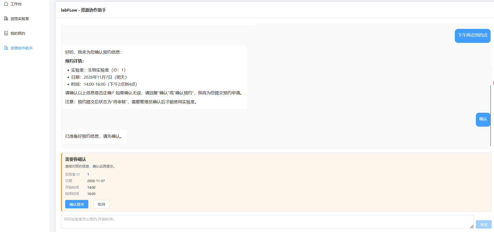
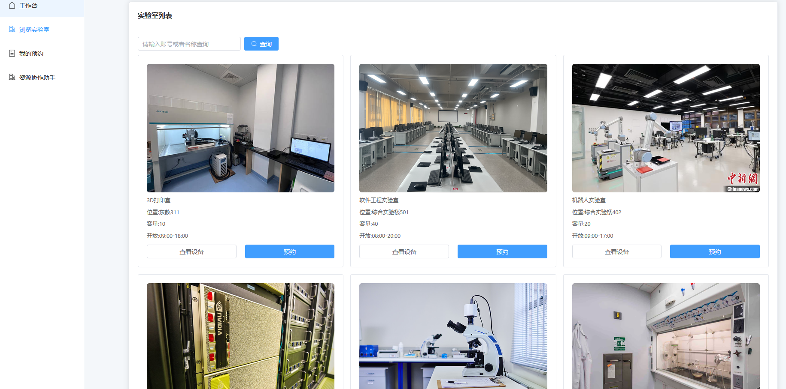
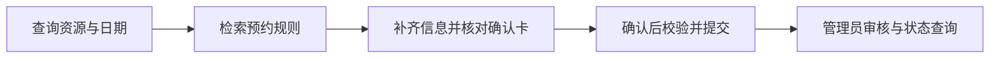
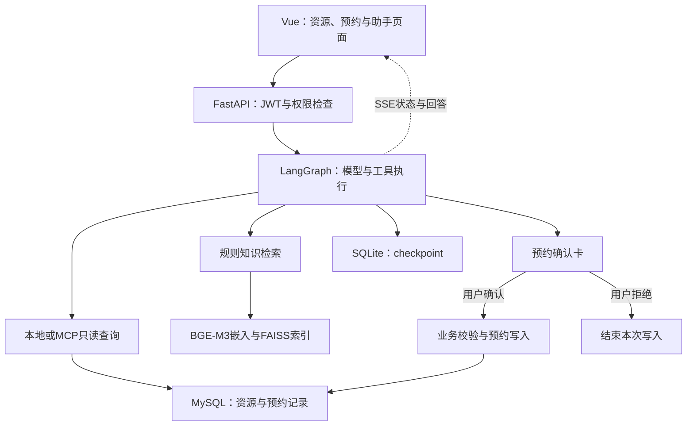

<h1 align="center">labFLow · 实验室资源协作助手</h1>

<p align="center"><strong>查清资源与规则，确认预约，再由管理员审核。</strong></p>
<p align="center">FastAPI × LangGraph × MCP · 资源管理、规则问答与预约协作</p>

<p align="center">
  
  
  
  
  
</p>

labFLow 面向共享实验室的资源查询、预约申请和审批管理。用户可以浏览实验室与设备，通过表单或自然语言表达预约需求；助手结合规则知识库和业务查询，在预约写入前等待用户确认，提交后进入管理员审核流程。

[项目快照](#screenshots) · [快速开始](#quickstart) · [使用指南](docs/USAGE.md) · [系统架构](docs/ARCHITECTURE.md) · [配置与维护](docs/OPERATIONS.md) · [测试说明](docs/TESTING.md)

<a id="screenshots"></a>

## 📷 项目快照

<p align="center">
  <a href="docs/assets/screenshots/assistant-confirmation.png">
    
  </a>
</p>
<p align="center"><sub>助手预约流程：核对资源与时段后，点击“确认提交”才执行预约工具。截图中尚未完成提交。</sub></p>

<details>
<summary><strong>展开查看实验室与资源浏览</strong></summary>

<p align="center">
  <a href="docs/assets/screenshots/laboratories.png">
    
  </a>
</p>
<p align="center"><sub>资源列表界面示例：查看实验室信息、开放时段，进入设备查询或预约。</sub></p>

</details>

## ✨ 可以完成什么

| 使用场景 | 可以做什么 | 结果在哪里核对 |
| --- | --- | --- |
| **查找资源与提交预约** | 浏览实验室、设备与开放时段，提交预约，查看或取消本人的待审核申请 | 资源列表与我的预约 |
| **向助手描述需求** | 查询资源、了解制度、补齐预约信息，并在确认后提交申请 | 对话中的确认信息与预约记录 |
| **管理与审核** | 管理资源和账号、审核预约、核验并处理账号恢复申请 | 对应的管理员页面 |

规则说明来自知识库，资源与预约信息来自业务数据库。预约是否已经提交、是否获批，以系统记录为准。

## 🧭 从一句需求到一张待审核预约

以学院共享实验室中的 GPU 工作站预约为例：

> 我想预约计算机实验室的 GPU 工作站，明天 14:00 到 16:00 使用，需要提前审核吗？



| 环节 | 平台提供的支持 | 用户参与 |
| --- | --- | --- |
| 资源核对 | 查询实际存在的实验室、设备、日期和开放时段 | 确认资源，补充缺失信息 |
| 规则说明 | 从规则文档中查找预约与使用制度 | 了解申请条件 |
| 提交确认 | 汇总资源、日期和起止时间，暂停预约写入 | 确认或拒绝本次申请 |
| 创建预约 | 复用业务服务校验日期、开放时段、设备状态与重叠预约，创建待审核记录 | 核对提交结果；失败时调整信息 |
| 后续协作 | 管理员审核，申请人查看状态 | 以审批结果安排使用 |

该过程依赖系统中已登记的资源和实际维护的制度。确认提交后仍需管理员审核；用户拒绝确认时，本次预约工具不执行写入。

## 🧩 关键设计与扩展

项目在参考项目基础上，围绕工具接入、执行控制、权限和账号恢复进行了扩展。

| 方向 | 当前实现 | 作用与代码入口 |
| --- | --- | --- |
| **MCP 只读工具** | 日期、实验室和设备查询接入 stdio MCP；服务不可用时回退本地查询工具 | 统一查询入口，写预约仍留在受控业务流程。[mcp_client.py](backend/app/services/mcp_client.py) |
| **预约前人工确认** | LangGraph 在预约写入工具前执行 `interrupt`，等待确认后恢复 | 将需求理解与业务写入衔接起来。[agent_service.py](backend/app/services/agent_service.py) |
| **执行状态保存** | AsyncSqliteSaver 保存图状态，checkpoint 按用户和会话定位，恢复前检查待确认操作 | 支持继续处理待确认申请。[access.py](backend/app/access.py) |
| **规则知识检索** | BGE-M3 嵌入与本地 FAISS；按标题组织文档，500 字符切分、50 字符重叠，检测规则变化 | 为制度问答提供相关正文，并支持索引重建。[kb_service.py](backend/app/services/kb_service.py) |
| **流式交互** | 携带 JWT 的 fetch 接收 SSE，处理分段数据帧、确认事件与连接中断 | 展示回答和执行状态。[ai.js](frontend/src/router/ai.js) |
| **站内账号恢复** | 核验表单、管理员收件箱、随机凭据、处理时间线和补充材料 | 将申请与处理结果连接起来，无需外部邮件服务。[recovery_service.py](backend/app/services/recovery_service.py) |
| **身份与维护隔离** | JWT 绑定密码版本，重置或改密后旧登录失效；维护能力额外检查管理员白名单 | 将账号管理、业务使用和开发维护分开。[jwt.py](backend/app/utils/jwt.py) |
| **回归与运行支持** | 权限、凭据、事务与初始化检查，配置模板、锁定依赖及受保护的示例初始化 | 支持独立配置与重复验证。[测试说明](docs/TESTING.md) |

## 🏗️ 系统如何协作



| 层次 | 当前技术 |
| --- | --- |
| 前端 | Vue 3、JavaScript、Vite、Element Plus、Axios |
| 服务与数据 | FastAPI、SQLAlchemy、MySQL、JWT |
| 智能编排 | LangGraph、兼容模型 API、MCP stdio |
| 知识检索 | BGE-M3 嵌入 API、本地 FAISS |
| 执行状态 | SQLite、LangGraph checkpoint |

FAISS 在本地完成向量检索，嵌入与回答生成调用配置的模型服务。用户身份来自后端认证，工具写入复用业务服务；公开对话事件会过滤内部工具预览。[查看详细架构](docs/ARCHITECTURE.md)

## 🔐 账号与协作

普通用户查询资源并管理本人预约；管理员维护资源、处理审核和账号恢复申请。维护接口同时要求管理员角色和 `DEVELOPER_USER_IDS` 白名单，业务管理员不自动获得维护权限。

忘记密码时，用户提交核验表单并保存申请凭据，通过凭据查看处理进度和补充材料。指定管理员核验后重置；用户首次登录须修改初始密码，再重新登录。[查看使用流程](docs/USAGE.md#账号恢复与处理跟进)

<a id="quickstart"></a>

## 🚀 安装与启动

### 环境要求

- Python 3.12。
- Node.js：22.x 不低于 22.18，或 24.12 及以上，具体范围见 [frontend/package.json](frontend/package.json)。
- MySQL 8.0 及以上。
- 支持聊天和嵌入接口的模型服务。

以下使用 Windows PowerShell，从项目根目录执行。已有 Python 3.12 环境时替换解释器路径。

### 1. 安装依赖并复制配置模板

```powershell
py -3.12 -m venv .venv
.\.venv\Scripts\python.exe -m pip install -r backend/requirements.txt
npm.cmd --prefix frontend ci
if (!(Test-Path backend/.env)) { Copy-Item backend/.env.example backend/.env }
if (!(Test-Path frontend/.env)) { Copy-Item frontend/.env.example frontend/.env }
```

在 MySQL 中创建数据库和专用账号，在 `backend/.env` 中填写 `DATABASE_URL`、随机的 `JWT_SECRET_KEY`、`LLM_BASE_URL`、`LLM_MODEL` 与 `SILICONFLOW_API_KEY`。首次管理员、恢复申请接收人和维护白名单的配置见[配置与维护](docs/OPERATIONS.md)。

服务会创建缺失的数据表；数据库及数据库账号需提前准备。可选示例数据初始化仅适用于受保护的空示例库，不覆盖已有业务数据。

### 2. 分别启动后端和前端

```powershell
# 后端：项目根目录
.\.venv\Scripts\python.exe -m uvicorn app.main:app --app-dir backend --host 127.0.0.1 --port 8000 --reload --reload-dir backend
```

```powershell
# 前端：另一个终端，项目根目录
npm.cmd --prefix frontend run dev -- --host 127.0.0.1
```

打开 Vite 输出的实际地址，默认 **http://127.0.0.1:5173**。前端模板通过同源代理将 `/router` 和 `/uploads` 转发到后端。分别在对应终端按 Ctrl+C 停止服务。

### 3. 维护规则与构建前端

规则文档位于 `backend/data/kb`，配置嵌入服务后可重建索引：

```powershell
Push-Location backend
..\.venv\Scripts\python.exe -m app.build_kb
Pop-Location
```

```powershell
npm.cmd --prefix frontend run build
```

构建产物位于 `frontend/dist`。服务部署需配置静态站点和 API 反向代理；开发代理不会写入构建产物。部署策略、规则更新和账号恢复配置见[配置与维护](docs/OPERATIONS.md)。

## 🧪 验证与检查

- **权限与账号恢复**：用户归属、角色、申请凭据、密码版本和处理事务。
- **预约确认**：确认、拒绝、中断保存和恢复，检查是否发生预约写入。
- **MCP 协议**：真实 stdio 子进程的工具发现、调用与 Agent 接入。
- **前端**：路由、凭据输入边界和生产构建。

测试模型和隔离数据库用于检查执行行为，真实模型回答质量和 MySQL 并发场景分别验证。运行命令及验收方法见[测试说明](docs/TESTING.md)。

## 📚 文档导航

| 想了解什么 | 推荐入口 |
| --- | --- |
| 查询资源、提交预约、确认与跟进 | [使用指南](docs/USAGE.md) |
| 了解 RAG、工具、确认节点和状态保存 | [系统架构](docs/ARCHITECTURE.md) |
| 配置数据库、账号、模型服务和知识库 | [配置与维护](docs/OPERATIONS.md) |
| 运行回归、协议与执行链路检查 | [测试说明](docs/TESTING.md) |

```text
backend/app/            接口、业务服务、智能编排与数据模型
backend/data/kb/        规则知识文档
backend/tests/          回归与协议检查
backend/init_demo.py    可选示例数据初始化
frontend/src/           页面、路由和API调用
docs/                   使用、架构、维护与测试文档
```

源码不携带真实配置、账号与预约数据、运行日志、模型权重或内部开发记录。规则文档和公开资源图片需按实际使用场景维护。

## 🤝 参考来源

项目启发于 B站 UP主程序员青戈的[《FastAPI + LangGraph 从零开发智能实验室预约系统》](https://www.bilibili.com/video/BV13hbP6zEUd)，并在此基础上围绕工具接入、执行控制、权限隔离和账号恢复进行了扩展。第三方依赖说明见[参考来源](THIRD_PARTY_NOTICES.md)。
