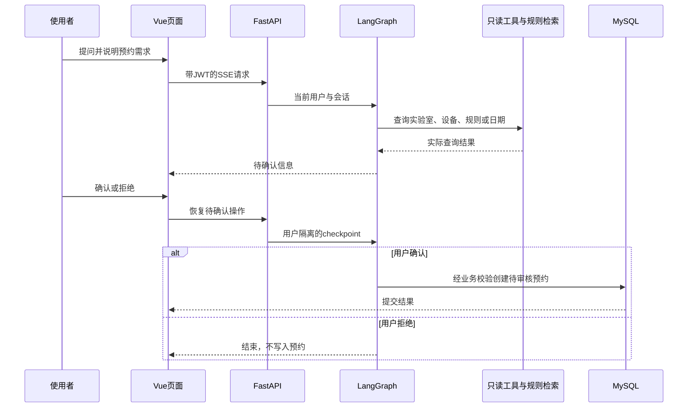

# 架构与关键设计

## 一次预约如何完成

## 模块职责

| 模块 | 关键设计 | 对应目标 |
|---|---|---|
| Vue与Axios | 页面、路由和API模块分开；普通页面只展示必要过程 | 用户能查资源、确认预约并理解结果 |
| FastAPI路由 | 输入校验、依赖鉴权与统一Response | 直接调用API也遵守角色及改密限制 |
| 业务服务 | db.query与事务处理预约、审核、取消 | 工具调用复用普通业务规则 |
| LangGraph | 工具循环、interrupt确认、SQLite checkpoint | 写入前可由用户决定，拒绝不落库 |
| MCP stdio | 只提供日期、实验室、设备查询 | 用协议调用工具，写入仍留在受控确认流程 |
| RAG/FAISS | 规则文档按500字符、50重叠切分，BGE-M3嵌入、归一化内积 | 回答规则时提供检索依据，当前默认top-k为4 |
| MySQL | 账号、资源、预约、找回申请与事件 | 结构化业务与申请处理可持久保存 |
| 维护权限 | 管理员角色加维护ID白名单；SSE过滤内部预览 | 业务管理员与开发维护能力分开 |

checkpoint内部键带真实用户ID，不能凭前端thread_id读取其他用户分支。恢复前检查待确认记录。JWT带密码版本指纹，更新密码后旧登录态失效。

## 找回密码

匿名用户提交核验表单，仅用户名必填。服务端指定收件管理员，创建申请并一次发放32字节随机量编码的43位凭据；数据库保存哈希，凭据有效30天。凭据查询和补充只针对该申请，不授予账号权限。

管理员查看声明信息与系统登记资料，独立核验后处理。只有核验并重置的本次申请，才可通过其凭据领取仍有效的初始密码；改密或后续重置后停止交付。第一次登录必须改密，服务端阻断其他业务操作。初始密码由服务端配置，相关部署策略见[配置与维护](OPERATIONS.md)。

## 存储和外部请求

MySQL保存业务数据，backend/data/checkpoints.sqlite保存图执行状态，backend/data/rag_index保存可重建向量。用户头像和资源图片是公开媒体，私人文档不应上传到这里。模型服务只收到对应提问、工具结果和检索证据，不应把数据表凭据加入提示词。

规则检索使用本地FAISS及OpenAI兼容嵌入接口；模型服务、数据存储与应用进程的运行配置见[配置与维护](OPERATIONS.md)。
