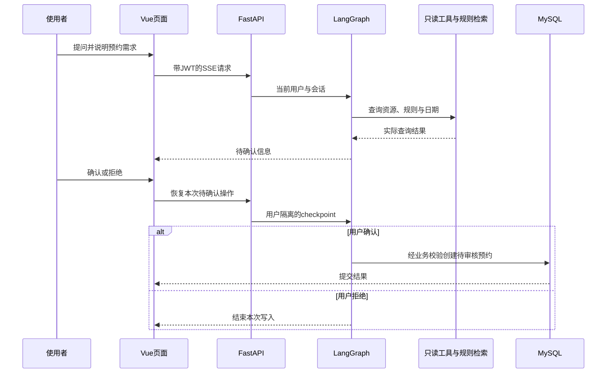
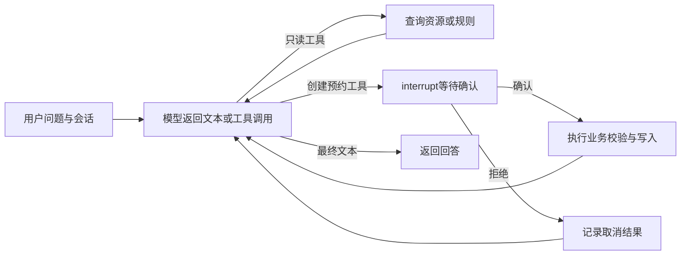

# 系统架构与关键设计

Vue 页面承担资源管理和交互，FastAPI 校验身份及业务输入，LangGraph 组织模型与工具调用。资源信息保存在 MySQL，使用制度进入知识库，图执行状态保存在 SQLite checkpoint。

## 组件与代码入口

| 组件 | 职责 | 实现入口 |
| --- | --- | --- |
| 页面与接口调用 | 资源、预约、账号和助手页面；路由权限及 API 调用 | [frontend/src](../frontend/src) |
| FastAPI 接口 | 请求校验、依赖鉴权、统一响应和 SSE | [app/router](../backend/app/router) |
| 业务服务 | 实验室、设备、预约与账号的规则和事务 | [app/services](../backend/app/services) |
| Agent 执行 | 模型选择工具，写入前确认，恢复待确认状态 | [agent_service.py](../backend/app/services/agent_service.py) |
| 工具与 MCP | 本地工具、日期与资源只读协议服务 | [agent_tools.py](../backend/app/services/agent_tools.py)、[mcp_client.py](../backend/app/services/mcp_client.py) |
| 规则检索 | 标题分段、文本切分、嵌入、索引和查询 | [kb_service.py](../backend/app/services/kb_service.py) |
| 用户与公开事件 | checkpoint 账号范围、公开 SSE 字段过滤 | [access.py](../backend/app/access.py) |
| 账号恢复 | 申请、凭据、补充材料与处理事务 | [recovery_service.py](../backend/app/services/recovery_service.py) |

## 一次助手预约如何完成

### 状态与工具执行

模型通过绑定的工具接口提出调用，`create_lab_reservation` 在执行前进入确认节点。`AsyncSqliteSaver` 保存消息和执行位置，恢复时校验当前用户、会话及待确认状态。

checkpoint 的内部键包含真实用户 ID 和会话标识；前端 `thread_id` 本身不授予其他用户会话的访问权。状态保存用于继续执行流程，不表示已经接入跨设备的完整会话管理产品。

### 业务服务负责最终写入

Agent 工具复用预约业务服务，检查日期与时间、实验室开放时段、设备存在及维护状态，并按当前资源范围检查重叠预约。创建成功后状态为待审核，后续审核与取消仍由业务服务处理。

对同一实验室加行锁用于串行化相关创建过程。设备数量、跨资源的容量规则和并发效果应按[运行约束](OPERATIONS.md#当前运行约束)单独验证，不能由工具调用成功推定。

## 规则知识库

规则文档位于 `backend/data/kb`。按标题组织后采用 500 字符切分与 50 字符重叠，使用配置的 `BAAI/bge-m3` 嵌入 API 建立归一化向量，并以 FAISS 内积检索；默认返回 4 个片段。

索引保存在 `backend/data/rag_index`。规则文件变更、增删或索引缺失会触发重建判断，也可通过维护入口显式重建。模型收到当前问题、对应工具结果和检索正文，数据库连接信息和服务密钥只保存在后端。

检索相似度用于反映匹配情况，未经概率校准，不代表回答正确的概率。模型生成与真实业务记录分别核对。

## MCP 只读查询

MCP stdio 服务提供 `get_today`、`search_open_labs` 和 `search_labs_equipment`。后端使用同一解释器启动子进程并传递必要配置，发现后替换对应本地查询工具；协议服务不可用时保留本地查询路径。

预约写入工具留在业务服务和确认流程中。MCP 提供查询能力，用户身份和业务写入权限仍由应用服务端控制。

## 账号、恢复申请与维护权限

JWT 携带密码版本信息，修改或重置密码后旧登录状态失效。待改密账号在服务端受到业务访问限制。

账号恢复请求只要求用户名必填，其他核验材料可选。服务端指定收件管理员，生成 32 字节随机量编码的 43 位凭据，仅保存哈希；凭据有效 30 天，只能查询和补充对应申请。

管理员独立核验材料。核验重置和申请状态同事务更新，本次申请通过凭据交付仍有效的初始密码；用户改密或再次重置后，旧申请停止交付。初始密码由服务端配置，具体策略见[配置与维护](OPERATIONS.md)。

资源管理员负责业务管理；维护操作同时检查管理员角色与维护白名单。公开 SSE 仅保留必要业务字段，内部工具预览不随普通响应返回。

## 数据存储

| 位置 | 内容 |
| --- | --- |
| MySQL | 账号、实验室、设备、预约、恢复申请及处理事件 |
| `backend/data/checkpoints.sqlite` | 图执行状态 |
| `backend/data/rag_index` | 可重建的 FAISS 索引与片段 |
| `backend/data/kb` | 原始规则文档 |
| `backend/uploads` | 头像及资源图片等公开媒体 |

私人文档和账号核验材料不应上传到公开媒体目录。规则、模型和数据的运行配置见[配置与维护](OPERATIONS.md)，验证入口见[测试说明](TESTING.md)。
